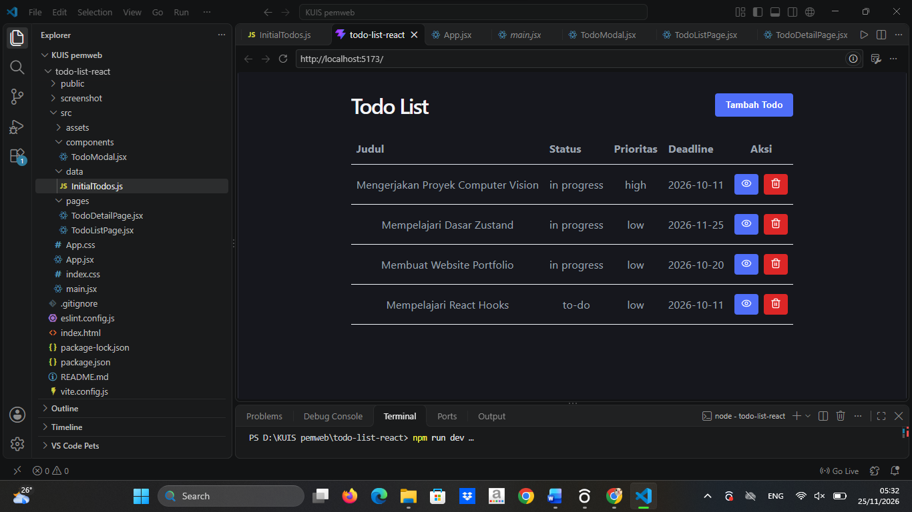
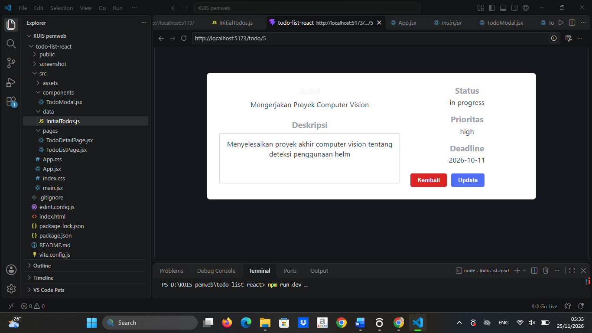
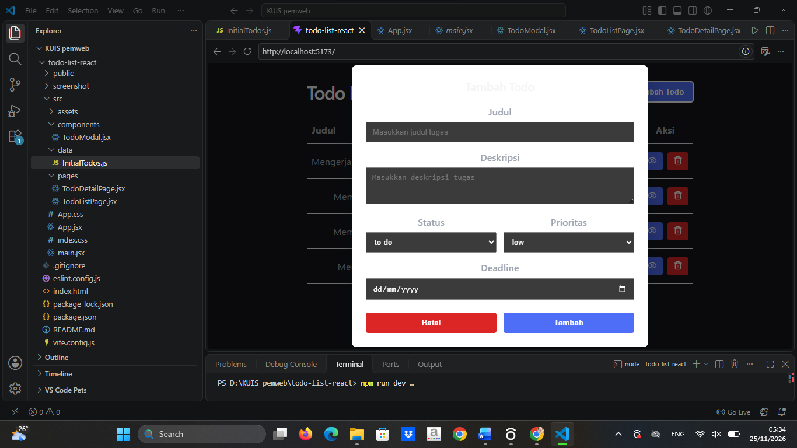
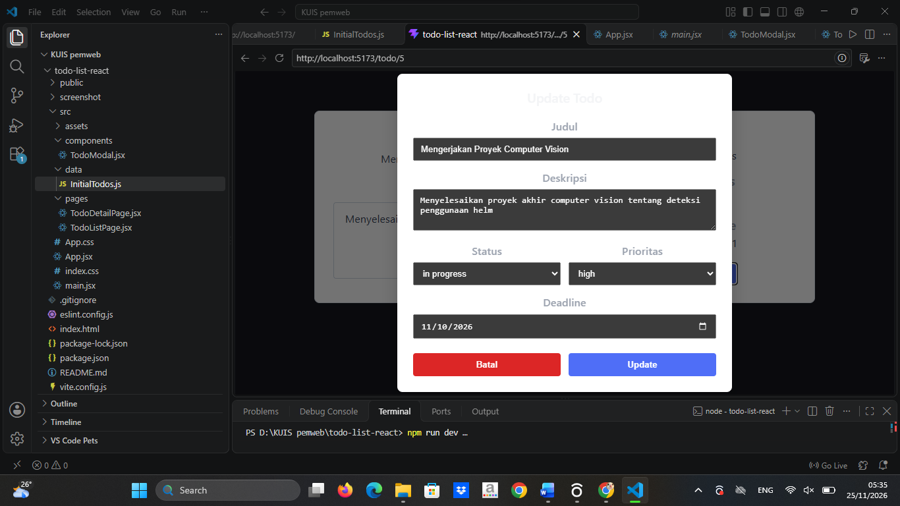
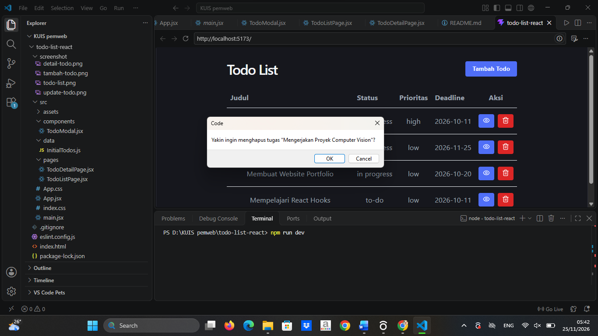

# To-Do List React

Aplikasi frontend daftar tugas menggunakan React.js dan React State untuk mengelola data tugas tanpa backend maupun pemanggilan REST API.

## Fitur
- Menampilkan daftar tugas (`id`, `title`, `description`, `priority`, `deadline`, `status`)

- Melihat detail tugas

- Menambahkan tugas baru

- Memperbarui informasi tugas

- Menghapus tugas dengan konfirmasi dan umpan balik


## Cara Menjalankan
1. Install dependensi:
   ```bash
   npm install
   ```

2. Jalankan server pengembangan:
   ```bash
   npm run dev